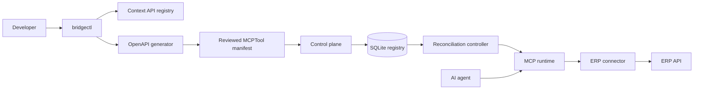

# ToolPlane reference implementation architecture

This note records the ERPBridge reference implementation and ERPBridge-Docs documentation used as evidence for the ToolPlane architecture. The verified source baseline is [ERPBridge commit `fe878a1`](https://github.com/nmdra/ERPBridge/commit/fe878a1). Public documentation is represented by [ERPBridge-Docs commit `289cbb4`](https://github.com/nmdra/erpbridge-docs/commit/289cbb4).

## Scope

ERPBridge connects ERP HTTP APIs to AI agents through MCP. It uses a generic HTTP connector. It does not contain a separate adapter for each ERP product.

## API to MCP flow

1. `bridgectl api register` stores the ERP endpoint and authentication metadata in a context-scoped local registry.
2. `bridgectl tool generate --api ... --openapi ...` calls `internal/idp/generator.go`.
3. The generator creates one MCP tool for each OpenAPI operation.
4. It preserves typed parameters, nested objects, arrays, enums, defaults, and required fields.
5. It records parameter locations as `path`, `query`, `header`, or `body`.
6. It considers only 200 and 201 JSON responses for output-schema generation and emits `responsePath: data` only when the selected response schema proves a top-level `data` property.
7. The generator returns a candidate resource. An operator reviews it before applying it.
8. Apply validates the resource and computes a canonical executable-content digest. The first apply stores server-authored admission bookkeeping; identical content is idempotent, while different content under the same name and version returns `REGISTRY_CONFLICT`.
9. Activation and serving selection are separate. The first active version becomes serving. Applying an admitted active version with `metadata.isServing: true` moves the unqualified-name pointer; other active versions remain available through protocol-safe exact names or digest binding.
10. Registration clones revisions into the in-memory registry. Invocation resolves and clones one revision before constructing middleware, then uses that snapshot through execution. A stale or inactive exact request fails without selecting another revision.
11. The reconciliation controller runs after the apply path and every 10 seconds. It repairs store--runtime divergence and continues after failed intervals. `/api/info` exposes process-local attempt, success, safe error, desired-hash, observed-generation, and convergence status. Cycle telemetry resets on restart; desired resources and soft-delete tombstones remain in SQLite. The controller does not implement a persisted Draft, Validated, or Superseded state machine.
12. Withdrawal and connector commitment use one process-local authority lock. Withdrawal-first prevents connector entry; commitment-first permits that invocation to complete before withdrawal is acknowledged. This boundary does not provide globally immediate revocation in a replicated deployment, and protected cache hits do not cross it.

## Endpoint selection

The endpoint selection behavior is intentional:

- OpenAPI generation uses the first `servers` URL when the specification provides one.
- Simple generation uses the registered API URL.
- The server-side API probe accepts a caller-supplied URL. The normal CLI path populates that request from the registered API record; the server does not look up that record.
- `ERP_BASE_URL` prefixes relative endpoints at runtime.
- `ERP_BASE_URL` can replace the scheme and host of local absolute endpoints.

## Tool invocation

MCP clients call a stable, intent-based tool name. ERPBridge then:

1. Applies authentication, role authorization, rate limits, concurrency limits, and cache rules.
2. Maps MCP arguments to the ERP request.
3. Resolves credentials from an environment variable or mounted file.
4. Sends the request through the resilient connector.
5. Applies retries for safe methods, circuit breaking, and bounded timeouts.
6. Decodes and validates the ERP response.
7. Returns MCP text. It assigns structured content only for `map[string]any` results with an output schema; arrays and scalars remain text-only through `executeToolCall`.

External plugins can process raw or normalized responses. ERPBridge calls plugins synchronously through `POST /v1/process` and does not retry plugin calls. Fallback returns an original response only when it can be normalized and validated against the tool schema. ERPBridge stores plugin configuration but does not deploy or manage plugin processes.

## Deployment architecture

The repository provides Docker Compose deployment for:

- `erpbridge-server` on port `8080`
- MockERP on port `8081` for development
- Redis for shared caching
- SQLite for the tool registry

The server supports MCP through protocol version 2025-11-25 and negotiates older supported versions. It does not claim conformance to MCP 2026-07-28.

The server supports these client surfaces:

- Streamable HTTP at `/mcp/`
- stdio with `erpbridge-server --stdio`; guarded tools fail closed because this transport has no HTTP caller identity
- Direct REST endpoints for `bridgectl` and administration
- Prometheus metrics and health endpoints

ERPBridge provides Kubernetes-style declarative resource concepts, not Kubernetes manifests or Helm deployment artifacts.

## AI-native bridge model

The MCP layer separates the AI contract from the ERP contract:

- AI tools use stable names, versions, descriptions, examples, and typed schemas.
- ERP endpoints remain technical execution details.
- Operators can expose only reviewed and active tools.
- Multiple MCP tools can use one ERP endpoint with different intent and mappings.
- The same OpenAPI contract can generate tools for different environments.
- Cache, rate limits, retries, and circuit breakers protect ERP services. Cache keys include the selected resource digest, or the version for programmatic tools without a digest. Protected cache hits still bypass final connector commitment and therefore require a separate release-time authority check for revocation guarantees.
- `credentialRef` values keep secrets out of manifests and registries.
- The unqualified MCP name resolves through a persisted operator-selected serving flag. Every active revision also has a protocol-safe exact name, and discovery publishes its resource digest and serving state.
- The shared MCP handler resolves one serving, exact-name, or digest-bound revision and clones it before constructing middleware. Registry and serving-pointer mutations therefore do not change the selected per-call resource.

## Conformance status against the normative contract

The proposed conformance contract is in `ToolPlane-Conformance-Contract.md`. ERPBridge commit `fe878a1` provides external tool state, a canonical admission digest and admission record, persisted serving selection, exact-name and client-carried digest binding, selected-revision schema validation, revision-scoped caches, an immutable per-call resource snapshot, synchronized single-process withdrawal versus connector commitment, final effective-origin enforcement with redirect suppression, process-local reconciliation status, periodic no-restart recovery, and credential references. Focused source-level tests cover these mechanisms. The implementation does not establish protected-cache release revocation, replicated final authority, durable cycle telemetry, or a completed live ERPNext conformance campaign. These are prototype or evidence gaps, not evidence that the architectural requirements are unnecessary.

## Source references

### ERPBridge

- `internal/idp/registry.go`
- `internal/idp/generator.go`
- `internal/mcp/tool.go`
- `internal/mcp/server.go`
- `internal/mcp/registry.go`
- `internal/mcp/middleware.go`
- `internal/connector/client.go`
- `docker-compose.yml`

### ERPBridge-Docs

- `docs/erpbridge/architecture.mdx`
- `docs/erpbridge/onboarding.mdx`
- `docs/erpbridge/tool-schema.mdx`
- `docs/erpbridge/connectivity.mdx`
- `docs/erpbridge/docker.mdx`
- `docs/erpbridge/plugins.mdx`
- `docs/erpbridge/agent-integrations.mdx`
