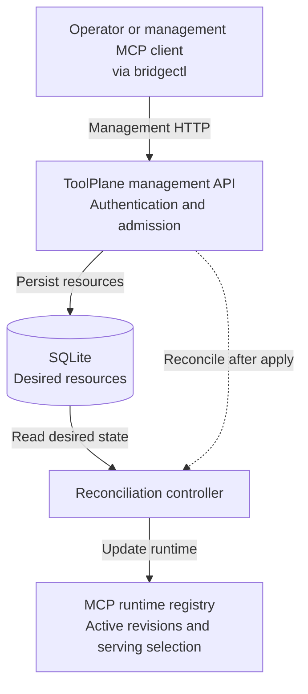
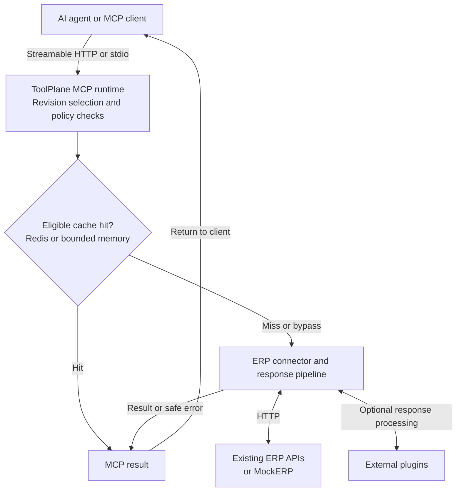

# ToolPlane: Declarative and Non-invasive ERP-to-MCP Control Plane

<a id="erpbridge-ai-to-erp-model-context-protocol-mcp-middleware"></a>

[](https://github.com/nmdra/ERPBridge/actions/workflows/release.yml)
[](https://go.dev/)
[](https://github.com/nmdra/ERPBridge)
[](https://modelcontextprotocol.io/)
[](https://opensource.org/licenses/MIT)

**Toolplane(previously known as ERPBridge)** is a declarative, non-invasive control plane that connects legacy Enterprise Resource Planning (ERP) systems to AI agents. It uses the **Model Context Protocol (MCP)** to expose existing ERP APIs as tools with input schemas. AI agents such as Claude, Cursor, or custom LLM chains can discover and call these tools.

ToolPlane is the current project name. Existing commands, configuration keys,
API namespaces, package names, and repository URLs retain their ERPBridge names.
This documentation rename does not change those interfaces.

## 🚀 Key Features

- **Model Context Protocol (MCP) Native**: Negotiates supported MCP protocol versions. See [AI Integration](#-ai-integration) for the base and negotiated versions.
- **Exact-Match Caching**: Uses an exact-match cache with Redis or a bounded in-memory LRU backend. Canonical SHA-256 hashing identifies tool arguments. Caching reduces repeated ERP API calls when enabled for a tool.
- **Rate Limiting**: Uses the token bucket algorithm to protect ERP systems. Authenticated callers share a limit across their sessions. Other calls use a session limit or a shared anonymous limit.
- **Resilience & Fault Tolerance**: Uses circuit breakers (Sony/GoBreaker) and retries (Avast/Retry-Go). The connector retries eligible failures only for GET, HEAD, and OPTIONS. It does not automatically replay POST, PUT, PATCH, or DELETE.
- **Secure Log Streaming**: Streams structured logs to MCP clients. Uses `masq` to redact sensitive data, including API keys, passwords, and PII. RFC 5424 levels control log delivery.
- **Multi-Transport Support**:
  - **Streamable HTTP**: Connects remote agents and web clients.
  - **Stdio**: Connects local IDEs and CLI agents.
- **Management CLI (`bridgectl`)**: Manages environments, validates schemas, calls tools, and monitors the server.
- **Metrics & Monitoring**: Exposes Prometheus metrics for performance and health.
- **External Plugins**: Calls separately deployed plugin processes through exact-version resources and bindings. ToolPlane does not install or start plugin processes.
- **ERPBridge Console**: Provides a read-only view of configured deployments through `bridgectl web`.
- **Management MCP Server**: Exposes management operations through `bridgectl mcp --stdio`. Write groups are disabled by default.

## 🏗️ Project Architecture

These diagrams show logical components, not deployment boundaries.

**Management and reconciliation**



**Tool execution**



The CLI sends resource changes through the management API. It does not write
directly to the server's SQLite database. Reconciliation updates the MCP runtime.

If Redis is not configured, the server uses a bounded in-memory LRU cache.
A cache hit returns the stored MCP result without an ERP or plugin call.
Plugins run as separate processes. ToolPlane does not install or start them.
See [Architecture](./docs/architecture.md) for execution order and
[Exact Match Caching](./docs/caching.md) for cache scope, expiration, and bypass rules.

- **`services/erpbridge-server/`**: The core Go service. It provides the MCP gateway and declarative control plane.
- **MockERP**: An independent FastAPI service in [`nmdra/mockerp`](https://github.com/nmdra/mockerp). ToolPlane uses its pinned GHCR image as the legacy ERP dependency.
- **`tools/bridgectl/`**: The management CLI for developers and AI agents. It uses Kubernetes-style resource commands.
- **`internal/`**: Go libraries for configuration, protocol handling, caching, and resilience.

## 🛠️ Getting Started

For a Windows CLI that manages an existing remote deployment, start with the
[PowerShell installation guide](./docs/windows.md). It does not require the
local development prerequisites below.

### Prerequisites

- **Go**: 1.26.2+
- **Docker & Docker Compose**: Required for container deployment.
- **Redis**: Optional. Without Redis, the server uses a bounded in-memory LRU cache.
- **SQLite**: Built in. Stores the tool registry.

### Quick Start (Docker)

Use Docker Compose to run the full stack:

```bash
make dev-up
```

If no credential source is supplied, this non-interactive bootstrap generates
temporary MockERP credentials. The bootstrap validates the Compose configuration,
force recreates the stack, and waits for both service health endpoints.
Direct `docker compose` use requires `MOCK_ERP_CREDENTIALS_JSON` or
`MOCK_ERP_CREDENTIALS_FILE`. Compose reads quoted `.env` values directly.
Do not source that file.

This launches:

- **ToolPlane server**: `http://localhost:8080`
- **Mock ERP**: `http://localhost:8081`
- **Redis**: Port `6379`

Then build the CLI. Generate and apply the default tool manifests:

```bash
make build
make generate-tools
```

> **Note:** Git does not track `schemas/`. Before it generates tools, `make generate-tools` downloads the pinned MockERP OpenAPI contract from GitHub. The task generates one temporary manifest and applies it once. When you upgrade MockERP, override `MOCK_ERP_VERSION` and `MOCK_ERP_OPENAPI_URL` together. See the [Onboarding Guide](./docs/onboarding.md) for the full procedure.

### Local Development

`make run-mock` uses Docker Compose. Supply the MockERP credentials described
in [Quick Start (Docker)](#quick-start-docker) before you run this command.

1. **Start the pinned MockERP image**:

   ```bash
   make run-mock
   ```

2. **Run the ToolPlane server**:

   ```bash
   # Server creates data/erpbridge.db automatically
   go run services/erpbridge-server/main.go
   ```

3. **Install `bridgectl`**:

   ```bash
   go install ./tools/bridgectl
   ```

4. **Install the bundled agent skill** (global by default):

   ```bash
   bridgectl skill install
   # Project-scoped: bridgectl skill install --project
   ```

5. **Initialize Tools**:

   ```bash
   make generate-tools
   ```

## 🔌 AI Integration

### Local Agents (Claude/Cursor)

Configure the agent to use the Stdio transport through the server binary:

```bash
erpbridge-server --stdio
```

### Remote / Web Clients

Connect through Streamable HTTP:

- **Base URL**: `http://localhost:8080/mcp/`
- **Transport**: MCP 2025-03-26 (the server negotiates up to `2025-11-25`)

For setup instructions and Postman collections, see the [Connectivity & Transport Guide](./docs/connectivity.md).

The ERP tool server and the management MCP server have different purposes.
Use `erpbridge-server --stdio` or `/mcp/` to call ERP tools. Use
`bridgectl mcp --stdio` for management operations. Read-only management tools
are enabled by default. An operator must explicitly enable a write group.
See the [Management MCP Server guide](./docs/bridgectl-mcp.md).

When `API_AUTH_TOKEN` is unset or empty, HTTP authentication is disabled.
Before you expose HTTP endpoints, configure bearer authentication and scoped
tokens as described in the [API Token Guide](./docs/tokens.md).

## 📚 Documentation

- [**Documentation Wiki**](./docs/README.md) - Index of the developer guides.
- [**CLI Reference**](./docs/cli/bridgectl.md) - `bridgectl` command reference.
- [**Management MCP server**](./docs/bridgectl-mcp.md) - Expose ToolPlane management operations to an AI coding agent.
- [**AI Agent Guide**](./AGENTS.md) - Agent integration and repository development rules.
- [**AI Skills**](./skills/bridgectl-ops/SKILL.md) - Instructions for AI agents that manage and troubleshoot ToolPlane.
- [**Docker Deployment**](./docs/docker.md) - Container deployment instructions and production requirements.
- [**Environment Variables**](./docs/environment-variables.md) - Server and CLI environment variable reference.
- [**REST API Reference**](./docs/api.md) - Direct HTTP endpoint reference.

## Related Projects

| Project | Purpose |
| --- | --- |
| [ERPBridge Plugins](https://github.com/nmdra/ERPBridge-Plugins) | External plugin processes and integration examples. Deploy plugins separately from the ToolPlane server. |
| [ERPBridge SDK](https://github.com/nmdra/erpbridge-sdk) | TypeScript client with MCP tool calls and typed REST clients. |
| [ERPBridge Documentation](https://github.com/nmdra/erpbridge-docs) | Source for the public documentation site. |
| [Public Documentation Site](https://toolplane.nimendra.online/) | Published server, `bridgectl`, plugin, and SDK guides. |
| [MockERP](https://github.com/nmdra/mockerp) | Test ERP service and the pinned OpenAPI contract. |

## 🛠️ Development & Contributing

### Testing

Run the full test suite:

```bash
make test
```

### Quality Control

Use `golangci-lint` and `lefthook` for pre-commit checks.

```bash
# Install hooks
lefthook install

# Run linting manually
make lint
```

See [CONTRIBUTING.md](./CONTRIBUTING.md) for how to report bugs and contribute.
