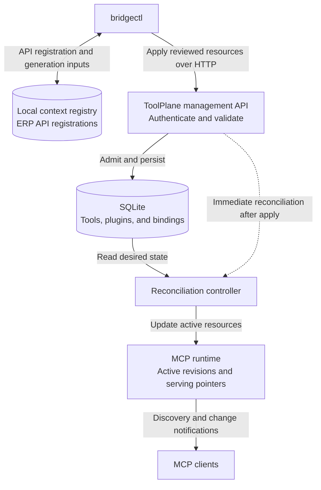
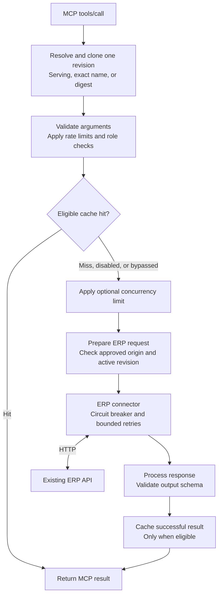
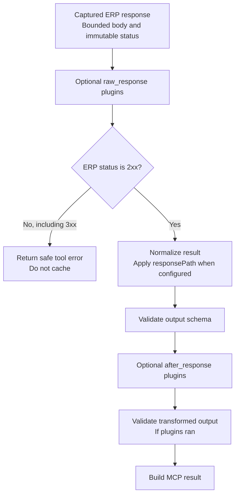
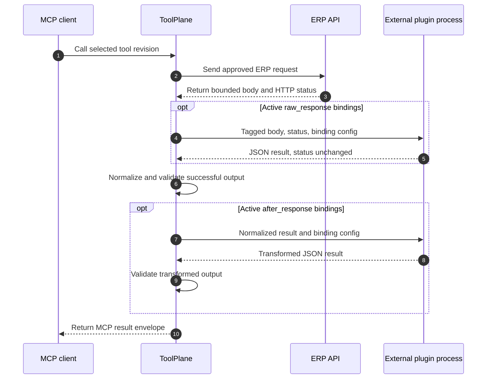

# ToolPlane V2 Architecture: Declarative Control Plane

ToolPlane V2 uses a **Declarative Control Plane** architecture based on Kubernetes concepts. An API manages MCP tool resources instead of static file-system configurations.

ToolPlane is the current project name. Existing ERPBridge commands, environment
variables, resource namespaces, and paths retain their names.

For implementation details about revision binding and execution authority, read [ToolPlane conformance mechanisms](./toolplane-conformance.md).

## 🏗 High-Level Overview

The system has three layers:

1. **Management Layer (The CLI)**: Developers use `bridgectl` to apply YAML/JSON resource definitions. These definitions declare the desired system state.
2. **Control Plane (The Server)**: A centralized API server stores tool definitions in a persistent SQLite database, validates them against strict admission rules, and manages versioning.
3. **Runtime Layer (MCP Engine)**: A background reconciliation controller keeps the active MCP server aligned with the desired state in the database.

The CLI registry and server registry have different purposes. Registering an
API changes the local context registry. Applying a reviewed resource sends a
management request to the server.

These are logical components, not container or network boundaries. The
controller also scans the store every 10 seconds. Dashed arrows show
reconciliation triggers; solid arrows show requests or state flow. The management MCP adapter
uses `bridgectl`; it does not write directly to the server database.

---

## 🧩 Endpoint vs. Tool: Key Concepts

Registering an **API Endpoint** and applying an **MCP Tool** are separate operations in ToolPlane V2.

| Feature | **API Endpoint** (`api register`) | **MCP Tool** (`tool apply`) |
| :--- | :--- | :--- |
| **Mental Model** | Technical Discovery | Declarative Management |
| **Primary Focus** | The ERP System (technical) | The AI Agent (semantic) |
| **Storage** | Local context API registry (`~/.bridgectl/registries/<context>.json`) | Server Registry (`erpbridge.db`) |
| **Visibility** | **Hidden from AI** | **Visible to AI** (as an MCP Tool) |
| **Stability** | Experimental / Internal | Versioned / Stable |
| **Command** | `bridgectl api register ...` | `bridgectl tool apply -f ...` |

### Why separate them?

- **Technical vs. Semantic**: Multiple MCP tools can use one ERP API endpoint (e.g., `/api/v1/resource/Employee`) with different filters or versions.
- **Safety**: Registering an API is a developer-only technical step. Applying a tool exposes its functionality to an AI agent.
- **Lifecycle**: You can discover and test 100 API endpoints locally. You can then apply only the 5 that are safe and ready for the LLM to use.

---

## 🛠 Core Components

### 1. Tool Resource Registry (The Source of Truth)

The server stores tool definitions in an internal **Tool Registry** backed by **SQLite**, not in a directory of files. The registry stores multiple versions of each tool for controlled rollouts and rollbacks.

Each admitted name and version is immutable executable content identified by a canonical SHA-256 digest and server-authored admission record. A changed definition requires a new version. `IsActive` controls exact-revision eligibility, while `IsServing` selects the active revision used by future unqualified calls. Soft deletion retains the resource but removes execution authority.

### 2. Version resolver and invocation snapshot

An unqualified request such as `list_employees` selects the operator-controlled serving revision, not the highest semantic version. Every active revision also has a callable protocol-safe exact name. Clients can bind an unqualified call with the digest published in MCP `_meta`. Exact requests never select a later revision.

ToolPlane clones the selected resource before argument validation and middleware construction. Validation, authorization, mapping, revision-scoped caching, response processing, and output use that one snapshot even if the serving pointer changes concurrently.

The following diagram shows a successful declarative ERP tool call. Failed
validation, policy, or dispatch checks stop execution and return an error.

Rate and role checks apply before cache lookup. A cache hit skips the
concurrency limit, ERP connector, and response plugins. File-backed credential
rules can bypass cache reads and writes. The connector retries only eligible
GET, HEAD, and OPTIONS failures. See [Connectivity](./connectivity.md#4-protection--limits)
for retry limits and [Caching](./caching.md) for cache eligibility.

### 3. Visibility Filtering (JSON-RPC Interception)

ToolPlane uses a **Visibility Filtering Layer** because the underlying MCP runtime does not always support tool removal from an active session.

- **The Problem**: A runtime library can retain a registered tool in memory until restart.
- **The Solution**: ToolPlane wraps the MCP server's HTTP handler and intercepts the `tools/list` response. Before the JSON-RPC result reaches the client, ToolPlane parses the list and removes any tools marked as `IsActive = false` in the internal registry.
- **Result**: The client receives a tool list that matches the control-plane state. The filter hides inactive tools even if the runtime retains them.

### 4. Final execution authority and target origin

Immediately before connector entry, ToolPlane validates the final effective request origin against the origins bound at admission. This check includes `ERP_BASE_URL` rewrites. The authority wrapper forces the production connector to return redirect responses without following them.

Withdrawal and connector commitment use one process-local synchronization boundary. If withdrawal commits first, the queued call fails with no connector entry. If connector commitment commits first, that call can complete before withdrawal is acknowledged. This is a single-process guarantee; it is not distributed revocation. Protected cache-hit revocation is outside this boundary and requires a separate release check.

### 5. Reconciliation Controller

The server runs a background reconciliation controller. It keeps the in-memory MCP registry in sync with the SQLite database.

The controller runs every 10 seconds. It compares the database state against the desired state:

- If a tool exists in SQLite but not in the registry, the controller registers it.
- If a tool is inactive (soft-deleted) or missing from SQLite, the controller deregisters it from the MCP runtime.
- If a tool changes, the controller re-registers the new version.

Each check uses a SHA-256 state hash from the store. The hash covers ordered tool, plugin, and binding identity, activity, update timestamp, and stored resource data. If the hash is unchanged, the controller skips the pass. This reduces reconciliation work.

The authenticated `/api/info` response exposes process-local reconciliation attempt count, last attempt, last success, safe error state, desired-state hash, observed generation, and convergence. Desired resources and soft-delete tombstones remain durable in SQLite; cycle timestamps and counters reset with the process. The periodic scan continues after failed intervals and can converge when dependencies recover without a restart.

When the registry changes, the controller sends the `notifications/tools/list_changed` notification to all active MCP sessions.

The controller also runs immediately after a `tool apply` HTTP request. The tool is visible to agents right after apply. It does not wait for the next 10-second tick.

### 6. External response plugins

ToolPlane invokes an already-running external plugin. The control plane stores
only the plugin endpoint and exact version. It never installs, starts, upgrades,
or schedules plugin code.

A `PluginBinding` connects one exact `Plugin{name, version}` to one exact
`MCPTool{name, version}`. A `raw_response` binding runs first and receives a
bounded ERP response with status, normalized content type, and a tagged JSON or
base64 body. It can adapt media, such as an ERP image to `{text: ...}`. The
plugin cannot change status or receive ERP headers, URLs, credentials, caller
identity, or original arguments. The developer owns the final object-shaped MCP
output schema; plugins never change it dynamically. An incompatible output
meaning requires a new MCP-visible tool name and exact tool version.

The response pipeline keeps ERP status separate from plugin output. Plugin
stages run only when active bindings exist. Each phase uses ascending binding
priority.

Terminal non-2xx responses can be inspected by raw plugins while retaining ERP
retry and circuit-breaker accounting. They remain errors, including 3xx. They
do not run success-only normalization or after-response processing. Output
validation also rejects results that do not match the declared schema.

The sequence below shows a successful MCP call on a cache miss or bypass.
It omits the policy and dispatch checks shown above. The same external plugin
can have bindings in both phases, or different plugins can serve each phase.

For object results with a declared output schema, the MCP result includes
structured content. Text content contains the JSON result, or the extracted
`text` field when applicable. The direct REST endpoint uses its separate
compatibility result shape; see the [REST API Reference](./api.md).

The response pipeline runs on a cache miss, or when caching is disabled or
bypassed. The cache stores the final transformed MCP result and never stores an error result, so a cache hit does not invoke ERP
or plugins. Applying, changing, or deleting a plugin or binding flushes the
affected tool cache entries. `continue` uses the original captured response
only when it satisfies the developer-owned final schema; otherwise it returns a
safe error. Use `fail` for media conversion unless a compatible fallback is
known.

---

## 🛠 Tool Generation & Templating

ToolPlane uses template-based tool generation, including bulk generation from OpenAPI:

1. **The Template**: A `Registered API` acts as the source of technical truth (URL, Auth, Module).
2. **The Spec**: An `OpenAPI Definition` acts as the source of semantic truth (Paths, Parameters, Descriptions).
3. **The Result**: The generator combines these sources into draft MCP tools with the environment's connectivity and security settings. Review the drafts before applying them.

To generate tools for different environments (Dev, Staging, Prod), use the same OpenAPI spec with a different registered API.

### Safe onboarding boundary

Onboarding has two independent state boundaries. The CLI stores API
registrations in a registry scoped to the selected context. The server stores
only reviewed, applied tool resources in its SQLite control plane. A generated
manifest is a temporary draft; a reviewed file under `manifests/<module>/` is
the owned source for an apply operation.

The default API test is an authenticated server-side probe. The server resolves
`credentialRef` and returns only status, content type, latency, and success. The
host-side `--local` path is an explicit diagnostic exception. Control-plane
requests use the context's host root; only an exact `/mcp` or `/mcp/` suffix is
normalized. Other paths stop with `CONTROL_PLANE_URL_INVALID` instead of being
sent to the MCP session endpoint.

A disposable Compose onboarding check is available at
`scripts/test-onboarding.sh`. It isolates the CLI home, project, ports, and
credentials, verifies duplicate and invalid-root recovery branches, and
removes its temporary resources on exit.

---

## 🔄 Lifecycle of a Tool Change

1. **Define**: Developer creates a V2 YAML schema for a new tool.
2. **Validate**: Run `bridgectl tool validate -f tool.yaml`. Make sure that the schema meets syntax and admission rules (e.g., no raw secrets).
3. **Apply**: Runs `bridgectl tool apply -f tool.yaml`.
4. **Store**: The ToolPlane API validates the payload again and saves it to the SQLite `tools` table.
5. **Reconcile**: The background controller detects the new DB entry and registers it with the `mcp-go` runtime.
6. **Execute**: AI agents now see the new tool and can invoke it immediately.

---

## 🛡 Security Design

- **Secret Decoupling**: Schemas never contain raw tokens or keys. They only contain a reference (`credentialRef`). At execution, the middleware resolves these references from environment variables or an explicitly configured mounted credential file.
- **Admission Controllers**: The API server rejects any tool definition that contains suspicious strings (like `token` or `key=`) in its endpoint path. Plugin endpoints must be absolute `http` or `https` URLs without userinfo, query parameters, or fragments.
- **Redaction**: Root, buffered, and MCP log sinks filter sensitive attributes using `internal/types/sensitive.go`. ERP request and response bodies are never logged.
