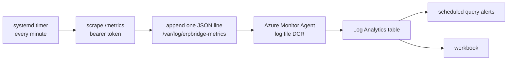

# Sending ToolPlane metrics to Azure Monitor

<a id="sending-erpbridge-metrics-to-azure-monitor"></a>

ToolPlane exposes Prometheus metrics at `/metrics`. Use this guide to select an
Azure Monitor collection method. The examples need deployment-specific setup;
they are not evidence of a tested Azure deployment.

## Scope and placeholders

Replace each placeholder with a value from your subscription:

| Placeholder | How to obtain it |
| --- | --- |
| `<SUBSCRIPTION_ID>` | `az account show --query id -o tsv` |
| `<RESOURCE_GROUP>` | The resource group that contains your ToolPlane host |
| `<REGION>` | The region of that resource group, for example `centralindia` |
| `<AMW_NAME>` | `az monitor account list --query '[].name' -o tsv` |
| `<AMW_QUERY_ENDPOINT>` | `az monitor account show -n <AMW_NAME> -g <AMW_RG> --query properties.metrics.prometheusQueryEndpoint -o tsv` |
| `<DCE_NAME>` | `az monitor data-collection endpoint list --query '[].name' -o tsv` |
| `<DCE_METRICS_HOST>` | `az monitor data-collection endpoint show -n <DCE_NAME> -g <DCE_RG> --query properties.metricsIngestion.endpoint -o tsv` |
| `<DCR_IMMUTABLE_ID>` | `az monitor data-collection rule show -n <DCR_NAME> -g <DCR_RG> --query immutableId -o tsv` |

Azure creates a default data collection endpoint (DCE) and a default Prometheus
data collection rule (DCR) with an Azure Monitor workspace. If
`az monitor account list` returns no workspace in the selected subscription,
use step B1 to create one. Use its default DCE and DCR unless you need separate
resources.

The command for `<DCE_METRICS_HOST>` returns an endpoint URL, not only a host
name. Do not insert that full URL after another `https://`. For remote write,
copy the complete metrics ingestion URL from your Azure Monitor workspace.
See B3 for the limits of the retained URL example.

## The `/metrics` endpoint

- Path: `/metrics`
- Format: Prometheus text exposition, `text/plain; version=0.0.4`, with
  `escaping=underscores` in the content type
- Authentication: when `API_AUTH_TOKEN` is set and nonempty, send a bearer
  token in the `Authorization` header. A non-admin token needs the `metrics`
  scope. If `API_AUTH_TOKEN` is unset or empty, HTTP authentication is disabled.

The following 401 result assumes that HTTP authentication is enabled. The 200
result assumes a valid token and a reachable server:

```bash
# 401 without a token
curl -sS -o /dev/null -w '%{http_code}\n' https://<your-bridge-host>/metrics

# 200 with a metrics-scoped token
curl -sS -H "Authorization: Bearer $METRICS_TOKEN" \
  https://<your-bridge-host>/metrics | head
```

With HTTP authentication enabled, create a scoped token:

```bash
bridgectl token create --name metrics-scraper --scope metrics --expires 8760h
```

Store the token in a file that only root can read on the scraper host. Do not
put the token in a manifest, a Compose file, or a world-readable environment
file.

## What is on the endpoint

The original guide listed 16 application metric families and estimated 55
families with the standard Go and process collectors. These numbers are an
original inventory and an unverified total, not guaranteed exports. The source
also defines `mcp_rate_limited_total`, included below. The families and series
visible in a scrape depend on the collectors, label initialization, and runtime
activity. See `internal/metrics/metrics.go` for the application definitions.

| Family | Type | Labels |
| --- | --- | --- |
| `mcp_requests_total` | counter | `method`, `status` |
| `mcp_tool_invocations_total` | counter | `tool`, `cache_status` |
| `mcp_tool_duration_seconds` | histogram | `tool` |
| `mcp_tool_errors_total` | counter | `tool`, `error_type` |
| `mcp_active_tool_calls` | gauge | `tool` |
| `mcp_rate_limited_total` | counter | `tool`, `scope` |
| `mcp_dependency_errors_total` | counter | `dependency`, `error_type` |
| `mcp_sessions_started_total`, `mcp_sessions_ended_total` | counter | none |
| `mcp_sessions_active` | gauge | none |
| `mcp_server_starts_total`, `mcp_server_stops_total` | counter | none |
| `erp_requests_total` | counter | `method`, `path`, `status` |
| `erp_request_duration_seconds` | histogram | `method`, `path` |
| `cache_hits_total`, `cache_misses_total` | counter | `type` on hits |
| `credential_resolutions_total` | counter | `source`, `outcome` |

**Volume warning.** Several families use a `tool` label. Each combination of
label values can add series. Actual series counts depend on tool activity,
labels, histogram buckets, and other runtime collectors.

The original estimate used 163 tools, about **2607 series**, and **1956**
`mcp_tool_duration_seconds_bucket` series (163 tools x 12 buckets). It estimated
roughly 3.75 million samples per day at a 60 second scrape interval. These are
unverified illustrative estimates, not measured deployment values. Measure
your endpoint before you calculate costs.

If you need counts but not tool-duration distributions, drop the duration
buckets to reduce sample volume:

```yaml
metric_relabel_configs:
  - source_labels: [__name__]
    regex: "mcp_tool_duration_seconds_bucket"
    action: drop
```

The following table retains the illustrative estimates. It does not predict
your deployment volume:

| Scrape interval | Samples per day | Samples per month |
| --- | --- | --- |
| 30 s | 7.5 M | 225 M |
| 60 s | 3.75 M | 113 M |
| 300 s | 0.75 M | 23 M |

## Which Azure Monitor paths are supported

The `ama-metrics` collector for Azure Monitor managed service for Prometheus
collects from supported **Kubernetes** deployments. Configure it with
`ServiceMonitor` and `PodMonitor` resources or a ConfigMap. This Kubernetes
collector does not directly scrape Azure Container Apps, standalone virtual
machines, or arbitrary HTTPS endpoints outside that setup. Do not use
`ServiceMonitor` as a host-level collection method for those platforms.

Select a method for your host and query requirements:

| | A. Host log pipeline | B. Prometheus remote write | C. Platform metrics only |
| --- | --- | --- | --- |
| Additional components | Scrape timer, JSON file, AMA, custom table, DCR | Prometheus, identity role, remote write | No application scraper; other setup can be necessary |
| Query language | KQL | PromQL | Azure Monitor metrics |
| Collected data | Selected application values | Selected `/metrics` series after filtering | Available resource metrics; depends on the host |
| Cost driver | Log ingestion, retention, queries, alerts as applicable | Samples ingested and queried; alerts as applicable | Standard platform metrics have no collection charge; alerts, tests, and other features can cost extra |

Use C for the platform metrics available on your resource. Add A for selected
application values on a supported Linux virtual machine. Use B when you need
PromQL queries and Grafana.

---

## Option A: a host log pipeline (lowest risk)

This example uses a Linux virtual machine with Azure Monitor Agent (AMA).
The heading does not establish that this is the lowest-risk method for every
deployment. Make sure that your VM meets the Microsoft prerequisites for JSON
log collection before you use this method. An arbitrary Container Apps
sidecar cannot use this VM log-file DCR method without a supported collection
architecture.

The diagram shows the proposed data flow. It does not establish a common or
tested ToolPlane deployment pattern:



### A1. Scrape to a bounded JSON line

Implement a scraper that writes one JSON line per interval. Include only the
values needed for your alerts. The following expressions describe possible
fields; they are not commands that a raw `/metrics` scrape can execute:

| Field | Source |
| --- | --- |
| `ToolCallsTotal` | `sum(mcp_tool_invocations_total)` |
| `ToolErrorsTotal` | `sum(mcp_tool_errors_total)` |
| `ErpRequestsTotal` | `sum(erp_requests_total)` |
| `ErpNon2xxTotal` | `sum(erp_requests_total{status!~"2.."})` |
| `ErpLatencyP95Ms` | `histogram_quantile(0.95, sum by (le)(rate(erp_request_duration_seconds_bucket[5m])))` |
| `McpSessionsActive` | `mcp_sessions_active` |
| `ActiveToolCalls` | `sum(mcp_active_tool_calls)` |
| `GoGoroutines` | `go_goroutines` |
| `ProcessResidentBytes` | `process_resident_memory_bytes` |

A single scrape provides current samples, not a PromQL query engine. The
`rate()` expression needs sample history. The percentile expression also needs
histogram aggregation. Use a PromQL engine with stored samples, or implement
the required history and calculations in your scraper. Do not treat the table
as a built-in JSON export feature.

The retained `ErpLatencyP95Ms` expression returns seconds because its source
histogram uses seconds. Convert that result to milliseconds before you write
it to `ErpLatencyP95Ms` or use the millisecond threshold in A3. The field name
alone does not change the unit.

Rotate the log file and retain only a few days of local data. Keep the token in
a separate root-only file from other monitoring credentials. Do not add a
secret to a hardened health unit designed to run without secrets.

### A2. Ship it with a log-file DCR

Use a separate DCR for the metrics log directory. The following JSON is a
**partial example, not a deployable DCR**. It omits the input schema and table
creation steps. Before deployment:

1. Create `ERPBridgeMetrics_CL` in the Log Analytics workspace. Use the custom
   table creation procedure in the [Microsoft JSON log collection guide](https://learn.microsoft.com/en-us/azure/azure-monitor/vm/data-collection-log-json).
2. Define the table columns and types for the JSON fields, including
   `TimeGenerated` with type `datetime`.
3. Add `properties.streamDeclarations` for `Custom-ERPBridgeMetrics`. Define
   its input columns and types, including `TimeGenerated`. The following
   example does not contain this required schema.
4. Make sure that the input schema, any transformation, and the destination
   table schema agree. If the JSON has no timestamp, use the documented
   ingestion-time behavior for `TimeGenerated`.
5. Install and configure AMA on the supported VM. Associate the completed DCR
   with that VM. Make sure that AMA can read the configured files.

Partial DCR structure:

```json
{
  "location": "<REGION>",
  "kind": "Linux",
  "properties": {
    "dataSources": {
      "logFiles": [
        {
          "name": "erpbridge-metrics-json",
          "format": "json",
          "streams": ["Custom-ERPBridgeMetrics"],
          "filePatterns": ["/var/log/erpbridge-metrics/metrics-*.jsonl"]
        }
      ]
    },
    "destinations": {
      "logAnalytics": [{ "name": "workspace", "workspaceResourceId": "<LAW_RESOURCE_ID>" }]
    },
    "dataFlows": [
      {
        "streams": ["Custom-ERPBridgeMetrics"],
        "destinations": ["workspace"],
        "outputStream": "Custom-ERPBridgeMetrics_CL"
      }
    ]
  }
}
```

Use the `Custom-` stream prefix and the `_CL` custom-table suffix as required
by the ingestion model. Use a separate stream and table to avoid changes to
the schema used by existing health workbooks.

### A3. Alert

After data reaches the table, use KQL for scheduled query alerts. These sample
thresholds need review for your deployment. The counter-difference query does
not account for counter resets or separate replicas:

```kql
ERPBridgeMetrics_CL
| where TimeGenerated > ago(15m)
| summarize errors = max(ToolErrorsTotal) - min(ToolErrorsTotal)
| where errors > 20
```

```kql
ERPBridgeMetrics_CL
| where TimeGenerated > ago(10m)
| where ErpLatencyP95Ms > 3000
```

---

## Option B: Prometheus remote write (full fidelity)

### B1. Create the receiving side, if you do not have it

If you do not have an Azure Monitor workspace, run only the first command in
the following block. Azure creates its default DCE and DCR automatically. Use
those defaults for the normal setup.

Run the second command only if you deliberately need a separate DCE. Do not
run it merely because you created a workspace:

```bash
az monitor account create \
  --name <AMW_NAME> --resource-group <RESOURCE_GROUP> --location <REGION>

az monitor data-collection endpoint create \
  --name <DCE_NAME> --resource-group <RESOURCE_GROUP> --location <REGION>
```

Only for a deliberately separate DCE/DCR setup, prepare the following
Prometheus rule file. Use the intended workspace and DCE resource IDs. If you
use the workspace defaults, skip this rule file and the rule creation command:

```json
{
  "location": "<REGION>",
  "properties": {
    "dataCollectionEndpointId": "<DCE_RESOURCE_ID>",
    "dataSources": {
      "prometheusForwarder": [
        { "name": "PrometheusDataSource", "streams": ["Microsoft-PrometheusMetrics"] }
      ]
    },
    "destinations": {
      "monitoringAccounts": [
        { "name": "MonitoringAccount", "accountResourceId": "<AMW_RESOURCE_ID>" }
      ]
    },
    "dataFlows": [
      { "streams": ["Microsoft-PrometheusMetrics"], "destinations": ["MonitoringAccount"] }
    ]
  }
}
```

```bash
az monitor data-collection rule create \
  --name <DCR_NAME> --resource-group <RESOURCE_GROUP> \
  --location <REGION> --rule-file prometheus-dcr.json
```

For a separate Prometheus forwarding DCR:

- The stream name is exactly **`Microsoft-PrometheusMetrics`**.
- A Prometheus forwarding rule does **not** set a `kind` value. The kinds
  `Linux`, `Windows`, `Direct`, and `WorkspaceTransforms` are for other
  workloads.

### B2. Grant the sender identity permission

Give the sender identity the **Monitoring Metrics Publisher** role on the
Prometheus DCR that receives the data. The remote-write client authenticates
with that identity. For a VM with an enabled system-assigned identity, use:

```bash
PRINCIPAL_ID=$(az vm identity show -g <RESOURCE_GROUP> -n <VM_NAME> --query principalId -o tsv)

az role assignment create \
  --assignee-object-id "$PRINCIPAL_ID" \
  --assignee-principal-type ServicePrincipal \
  --role "Monitoring Metrics Publisher" \
  --scope "/subscriptions/<SUBSCRIPTION_ID>/resourceGroups/<DCR_RG>/providers/Microsoft.Insights/dataCollectionRules/<DCR_NAME>"
```

If a managed identity is not available, the documented alternatives include
an Entra application with a client secret. Select one authentication method.
Keep the credential out of the scrape configuration. Do not put secrets in
shared or world-readable configuration files. Review the authentication-specific
version and storage requirements in the
[remote-write guide](https://learn.microsoft.com/en-us/azure/azure-monitor/metrics/prometheus-remote-write).

### B3. Configure Prometheus

**The retained example below is incomplete. Do not use it as a production
configuration.** Its `azuread` block selects a cloud but not an authentication
method. Its URL template also treats `<DCE_METRICS_HOST>` as a host name,
although the placeholder command returns a full endpoint URL.

For a system-assigned managed identity, use Prometheus 3.5.0 or later. Under
`azuread`, add a `managed_identity` block with `client_id: ""`, as specified in
the Microsoft remote-write guide. Replace `remote_write.url` with the actual,
complete metrics ingestion URL from your workspace. Do not prefix that URL
with another `https://` or append a duplicate path.

Original partial example:

```yaml
global:
  scrape_interval: 60s

scrape_configs:
  - job_name: erpbridge
    metrics_path: /metrics
    scheme: http
    static_configs:
      - targets: ["127.0.0.1:8080"]
    authorization:
      type: Bearer
      credentials_file: /etc/erpbridge-metrics/token
    metric_relabel_configs:
      - source_labels: [__name__]
        regex: "mcp_tool_duration_seconds_bucket"
        action: drop

remote_write:
  - url: "https://<DCE_METRICS_HOST>/dataCollectionRules/<DCR_IMMUTABLE_ID>/streams/Microsoft-PrometheusMetrics/api/v1/write?api-version=2023-04-24"
    azuread:
      cloud: AzurePublic
```

Notes:

- If the scraper runs on the same host, scrape the loopback address. Do not
  send the scrape through a public reverse proxy.
- If one address load-balances several replicas, a scrape can reach different
  replicas. Scrape each replica separately, or use a single replica.
- A completed managed-identity configuration needs no client secret. The
  original `azuread` block alone does not select that method.
- Pin a Prometheus version that supports your selected authentication method.
  Make sure that a remote write succeeds before you rely on its data.

### B4. Verify

After a successful remote write, run this query in the Azure Monitor
workspace Prometheus explorer. Make sure that it returns the expected
application series:

```promql
count({__name__=~"mcp_.*"})
```

### B5. Alert and visualize

- **Prometheus rule groups** (`Microsoft.AlertsManagement/prometheusRuleGroups`)
  evaluate PromQL alert expressions against the workspace.
- **Azure Managed Grafana** (`Microsoft.Dashboard/grafana`) uses the workspace
  query endpoint for its Prometheus data source.

Azure Monitor workspace data retention is 18 months with no separate storage
charge. Prometheus charges depend on samples ingested and query samples
processed. Review scrape intervals, relabel rules, queries, and alert costs
before deployment.

## Option C: platform metrics with no new components

Use the platform metrics available for your Azure resource. Container Apps
provides request, replica, and resource metrics. Do not assume that every host
automatically provides CPU, memory, disk, and network metrics. Guest metrics
can need an agent or other configuration.

Select the metrics and alerts that detect your host failures. If appropriate,
configure an availability test against `/mcp/health`. Platform metrics do not
replace application metrics from `/metrics`.

Standard platform metric collection has no charge. Alerts, availability tests,
API access, and related services can have charges. Check the current pricing
for your configuration; this method is not universally free.

## Limits and caveats

- Use no more than **63 labels** per time series. Label names can have up to
  511 characters. Label values can have up to 1023 characters.
- Azure Monitor treats label names **case-insensitively**, so two labels that
  differ only by case can conflict.
- Counter names ending in `_total` are not renamed on ingestion. Keep the
  exported Prometheus spelling in queries.
- Classic histogram buckets retain the `le` label. When you calculate a
  histogram percentile, use `histogram_quantile()` and group by `le`.
- Do not use a summary's `quantile` label as a histogram bucket.
- If a series exceeds the label count, label-name length, or label-value
  length limit, the entire scrape job can fail and its metrics can be dropped
  before ingestion. Monitor the scraper's `up` series and target errors.
- The `/metrics` content type carries `escaping=underscores`. Any parser must
  accept that parameter. Make sure that your Prometheus or OpenTelemetry
  Collector version accepts the response before deployment.
- AMA log-file collection on VMs does not scrape `/metrics`. Option A needs
  your separate scraper. The `ama-metrics` collector is for supported
  Kubernetes collection.

## Related

- [Environment Variables Reference](./environment-variables.md)
- [API Token Guide](./tokens.md)
- [Connectivity & Transport Guide](./connectivity.md)
- [ERPBridge Console](./web-console.md)

## Sources

Use these Microsoft references for current prerequisites, configuration, and
pricing. Azure behavior and supported versions can change:

- [Collect JSON logs with Azure Monitor Agent](https://learn.microsoft.com/en-us/azure/azure-monitor/vm/data-collection-log-json):
  custom table, input schema, `TimeGenerated`, and VM collection requirements.
- [Manage an Azure Monitor workspace](https://learn.microsoft.com/en-us/azure/azure-monitor/metrics/azure-monitor-workspace-manage):
  automatic default DCE and DCR creation.
- [Send Prometheus data with remote write](https://learn.microsoft.com/en-us/azure/azure-monitor/metrics/prometheus-remote-write):
  ingestion URL, identity configuration, and Prometheus version requirements.
- [Azure Monitor cost and usage](https://learn.microsoft.com/en-us/azure/azure-monitor/usage-estimated-costs):
  ingestion, queries, retention, standard metrics, alerts, and other charges.
- [Azure Monitor Prometheus metrics details](https://learn.microsoft.com/en-us/azure/azure-monitor/metrics/prometheus-metrics-details):
  label limits and ingestion behavior.

Local implementation references are `internal/metrics/metrics.go`,
`services/erpbridge-server/main.go`, and `internal/mcp/auth.go`. These define
the application metric families, the `/metrics` route, and its authentication
conditions. They do not establish that the Azure examples were deployed.
